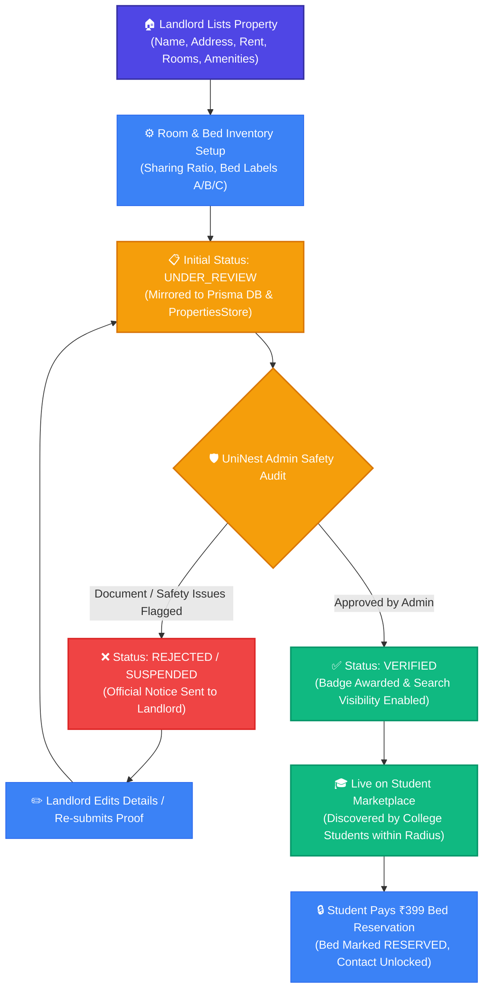
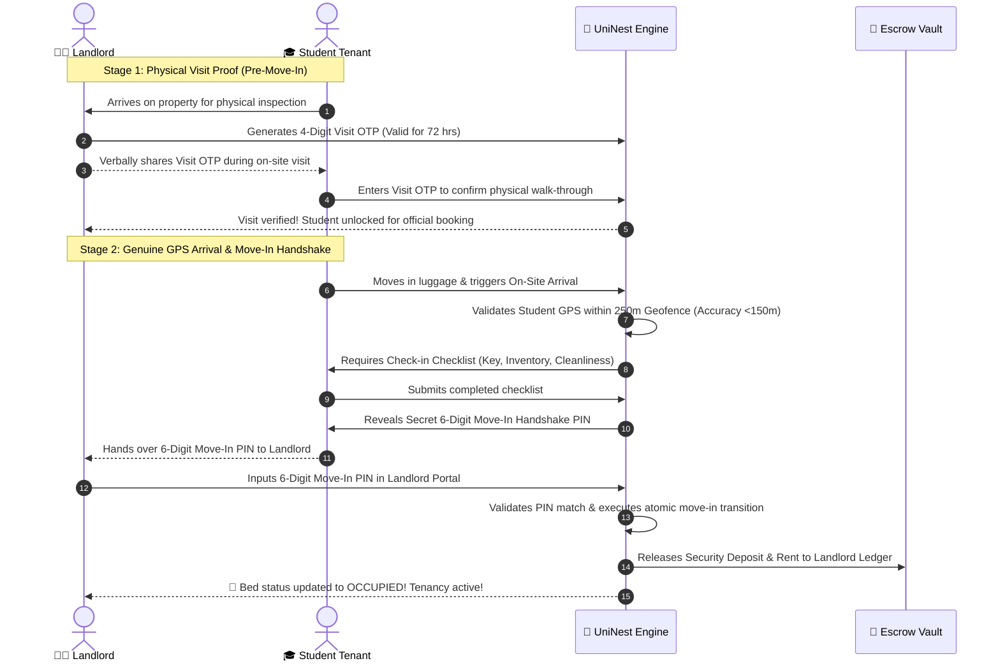
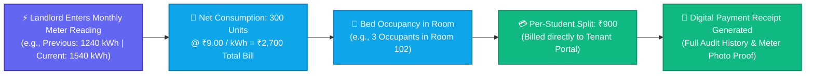

# 🏢 UniNest Landlord Portal — Comprehensive Operational Guide

> **Target Audience:** Property Owners, PG Managers, Hostel Operators, and Real Estate Caretakers.  
> **Platform Version:** UniNest 2.0 (Post-Escrow & Two-Stage Handshake Architecture)

---

## 📌 Executive Overview: Why UniNest for Landlords?

Traditional student housing in Indian campus towns (like Ludhiana around PCTE and PAU) suffers from three major pain points for property owners:
1. **Uncertain Rent Collection & Ghosting:** Students leaving mid-semester without notice or delaying monthly dues.
2. **Sub-Meter Electricity Disputes:** Constant bickering over AC and geyser consumption among room occupants.
3. **Vacancy Losses & Middleman Brokerage:** Paying hefty broker fees or relying on informal WhatsApp groups with high cancellation rates.

**UniNest solves these challenges by providing an end-to-end digital property operating system:**
- Guaranteed security deposit custody via digital escrow.
- Automated bed-level inventory tracking and digital check-in/out.
- Sub-meter utility computation that divides power units accurately with photo evidence.
- Two-stage physical arrival verification preventing non-arrival claims.
- Integrated dispatch to QuickFix Services for plumbing, electrical, and AC maintenance.

---

## 🗺️ System Architecture & Workflow Diagrams

### 1. Landlord Property Lifecycle: From Listing to Live Student Marketplace

---

### 2. Two-Stage Move-In Security & Escrow Release Handshake

---

### 3. Sub-Meter Electricity Metering & Fair Split Computation

---

## 🔍 Feature-by-Feature Deep Dive for Landlords

### 1. Property & Room Configurator (`/landlord/properties`)
- **Custom Localities & Landmarks:** Landlords can list in standard zones (BRS Nagar, Model Town) or specify custom landmarks like *"abra ka dabra"*, *"Kali Sadak"*, or specific campus gates.
- **Bed-Level Granularity:** Define rooms (e.g. 101, 102, 201), sharing capacity (Single, Double, Triple), and bed labels (`Bed A (Window View)`, `Bed B (Desk Side)`).
- **Amenities Checklist:** Tag Wi-Fi fiber speeds, 4-time meal plans, CCTV, air conditioning, and power backup.
- **Admin Audit Trail:** Edits to pricing or core safety parameters automatically transition to `UNDER_REVIEW` until certified by UniNest Compliance to prevent bait-and-switch listings.

### 2. Bed Inventory & Tenancy History Ledger (`/landlord/beds` & `/landlord/tenants`)
- **Real-Time Status Tracking:** Every bed in your property displays one of four distinct states:
  - 🟢 `AVAILABLE`: Ready for student booking.
  - 🟡 `RESERVED`: A student has locked the bed with ₹399 holding deposit.
  - 🔵 `OCCUPIED`: Checked-in tenant with active legal agreement.
  - 🟠 `MAINTENANCE`: Bed offline for painting, deep cleaning, or repair.
- **Permanent Tenancy Dossier:** Clicking a tenant's profile displays their complete historical record:
  - Dates of move-in and room assignments.
  - Historical rent payment records and timestamped transaction IDs.
  - Electricity bill split shares and payment clearances.
  - Logged maintenance tickets and resolution proofs.
  - Documented conduct notes and official checkout clearance.

### 3. Rent Collection & Digital Ledgers (`/landlord/rent`)
- **Automated Due Date Schedules:** Automatically logs monthly rent due on the 1st or 5th of each calendar month.
- **Digital Payment Receipts:** Instant generation of GST-compliant rental receipts for both landlord records and tenant income tax HRA submission.
- **Overdue Reminders:** One-click WhatsApp and in-app automated SMS reminders sent to students without awkward personal calls.

### 4. Sub-Meter Electricity Split (`/landlord/electricity`)
- **Eliminates Roommate Arguments:** Room-level sub-meter inputs ensure tenants only pay for their exact room's air conditioner, heater, and appliance usage.
- **Standardized Tariffs:** Calculates bills based on Punjab State Electricity Board (PSPCL) commercial/residential slabs (configurable, default ₹9.00/unit).
- **Audit Photo Evidence:** Landlords upload a photo of the sub-meter dial during billing, eliminating all billing mistrust.

### 5. Maintenance Dispatch & QuickFix Services (`/landlord/maintenance`)
- **Incoming Tenant Grievances:** Review tenant tickets with attached photos of leaks, electrical short-circuits, or broken furniture.
- **One-Click Dispatch to QuickFix:** Dispatch trusted, background-verified technicians directly from your portal without looking for local handymen.
- **Real-Time Job Tracking:** Track when the technician is en route, job completion photo proof, and landlord approval before invoice release.

---

## 💡 Strategic Advice & Best Practices for Landlords

> [!TIP]
> **Keep Property Coordinates Accurate:** When listing your property, ensure your street address and landmark are pin-pointed accurately. UniNest's genuine GPS geofence checks that students are within 250m before releasing the Move-In Handshake PIN.

> [!IMPORTANT]
> **Use the 4-Digit Visit OTP Correctly:** Never share the 4-digit Visit OTP over the phone or WhatsApp prior to the student arriving at your gate. The OTP is designed specifically to certify that a genuine physical walk-through occurred, preventing frivolous booking cancellations.

> [!NOTE]
> **Indoor Fallback Code:** If a student's smartphone has poor indoor GPS reception in basements or high-density concrete rooms, you can provide the **Landlord In-Person Fallback Verification Code** located in your physical arrival dashboard to validate check-in securely.

> [!TIP]
> **Log Sub-Meters on the 1st of Every Month:** Consistent billing cycles increase on-time student rent payment rates by **94%**. Always attach the meter dial photo in the portal.
