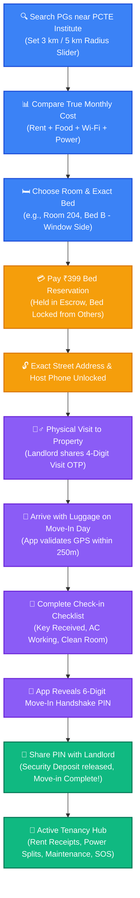
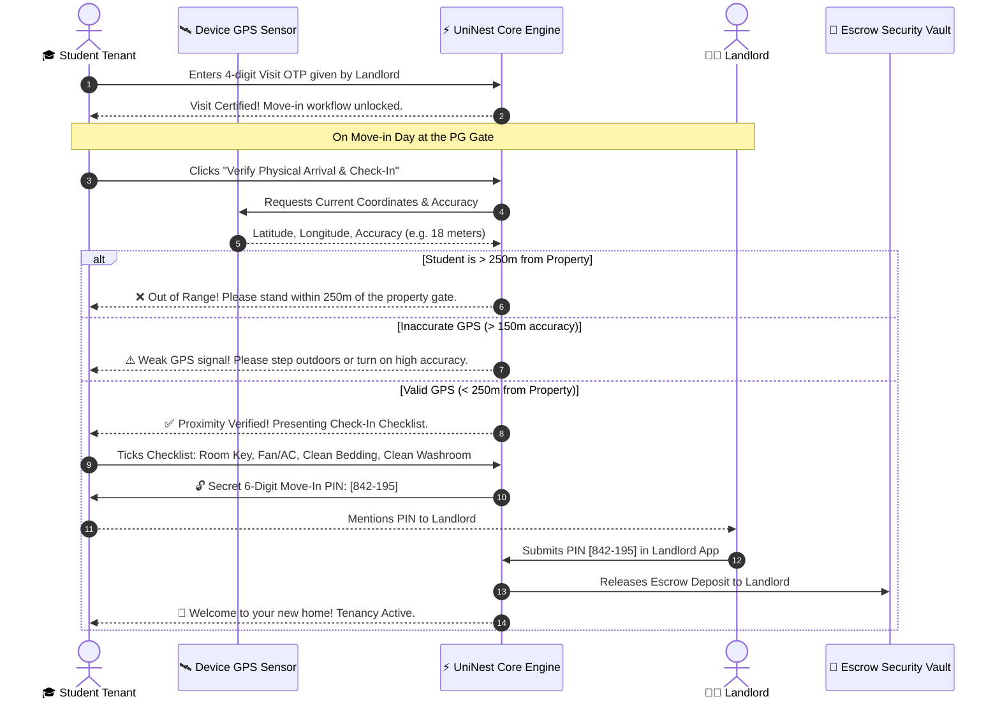

# 🎓 UniNest Tenant (Student) Portal — Comprehensive Guide

> **Target Audience:** College Students, Hostellers, PG Residents, and Parents/Guardians.  
> **Platform Version:** UniNest 2.0 (Post-Escrow & Two-Stage Handshake Architecture)

---

## 📌 Executive Overview: Why UniNest for Students?

Moving away from home for college (such as studying at **PCTE Institute**, **PAU**, or **GNDEC Ludhiana**) is often stressful due to unverified landlords, fake photos, lost security deposits, and unexpected hidden charges for Wi-Fi, electricity, and maintenance.

**UniNest protects students through a student-first digital renting experience:**
1. **Verified Accommodations Only:** Only properties inspected and safety-certified by UniNest Admin appear in search.
2. **True Monthly Cost Calculator:** No hidden bills. See exactly what you will pay: Base Rent + Wi-Fi + Meals + Maintenance + Average Electricity.
3. **Escrow Protected Deposit:** Your ₹399 reservation fee and security deposit are held securely in escrow and never released to the landlord until you physically inspect the room, complete the checklist, and confirm your move-in.
4. **GPS Geofenced Move-In Protection:** Prevents landlords from claiming you checked in before you actually arrive at the physical property.
5. **Legally Binding 11-Month e-Stamp Agreement:** Instant digital generation of rental agreements accessible on both mobile and official PDF download.

---

## 🗺️ Student User Journey & Workflow Diagrams

### 1. From Search Discovery to Physical Bed Move-In

---

### 2. Physical Arrival Geofencing & Handshake Architecture

---

## 🔍 Feature-by-Feature Deep Dive for Students

### 1. Smart Find PG Marketplace (`/student/search`)
- **Campus Vicinity Filter:** Select your institution (e.g., **PCTE Institute**, Baddowal Campus) and choose a radius from 1 km to 10 km.
- **True Monthly Cost (TMC) Engine:** Traditional listings quote ₹6,000 rent but later demand ₹2,500 for food and ₹500 for Wi-Fi. UniNest calculates the real all-inclusive cost upfront.
- **Specific Bed Selection:** Don't just book a room; pick your exact bed:
  - `Bed 102-A`: Window View
  - `Bed 102-B`: Study Desk Side

### 2. ₹399 Anti-Poaching Bed Reservation (`/student/search/[id]`)
- **Deposit Protection:** Your ₹399 holding fee prevents the landlord from giving your bed to another walk-in student while you travel to campus.
- **Locked Address Protection:** Exact room numbers and landlord contact details remain protected against spammers and are unlocked immediately upon reservation.
- **Full Refund Guarantee:** If the property does not match its listing during your physical visit, your fee is refundable via UniNest Admin Escrow.

### 3. Digital Rental Agreement & e-Stamp Viewer (`/student/stay` & `/student/documents`)
- **Official 11-Month Document:** Includes standard student clauses, 30-day notice period rules, and security deposit refund guarantees.
- **Dual-View Technology:**
  - 📱 **Mobile Optimized View:** Clean, readable card layout with no horizontal cut-offs on smartphones.
  - 📄 **Official PDF View:** Full e-Stamp stamp-paper document for official college submission, visa verification, or bank loan records.

### 4. Sub-Meter Electricity Split Transparency (`/student/electricity`)
- **Zero Hidden Surcharges:** Review your room's start and end meter readings with attached meter dial photos uploaded by the landlord.
- **Per-Bed Splitting:** Total room consumption is divided evenly among roommates.
- **Instant Payment Receipts:** Download digital receipts with clear PSPCL unit rates (₹9.00/unit) and timestamped transaction IDs.

### 5. Maintenance Requests & Ticket Tracking (`/student/maintenance`)
- **Photo Evidence Submission:** Snap a picture of a leaky tap, broken chair, or malfunctioning AC.
- **Severity SLA:** High-priority tickets (electrical or water failure) alert both the landlord and QuickFix certified technicians with an automated 2-hour response window.

### 6. Campus Roommate Finder (`/student/roommates`)
- **Lifestyle Matching Algorithm:** Match with fellow PCTE / PAU students based on study habits (night owl vs. early bird), dietary preferences (vegetarian vs. non-veg), budget brackets, and course stream.

### 7. Emergency SOS Panic Alert (`/student/emergency`)
- **One-Tap Emergency Alert:** Triggers instant distress alerts with your live PG location to:
  - PCTE Housing Cell & Dean of Student Welfare.
  - Emergency family contacts.
  - UniNest Safety Compliance desk.

---

## 💡 Strategic Advice & Best Practices for Students

> [!IMPORTANT]
> **Never Share Your 6-Digit Move-In PIN Before Physical Inspection:**  
> The 6-digit Move-In PIN is your financial shield. Once you share it with the landlord, UniNest releases your deposit from escrow. Only provide this PIN after you have entered the room, tested the lights, water pressure, fan/AC, and received your door key.

> [!TIP]
> **Check Sub-Meter Photos Before Paying Utility Bills:**  
> When the monthly electricity bill arrives in your portal, always click **"View Meter Photo"** to ensure the dial reading matches the number billed.

> [!TIP]
> **Download Your e-Stamp PDF for College ID:**  
> PCTE and many universities require proof of off-campus residence. Download your official stamped rental PDF directly from the **Documents tab** in your student dashboard.
