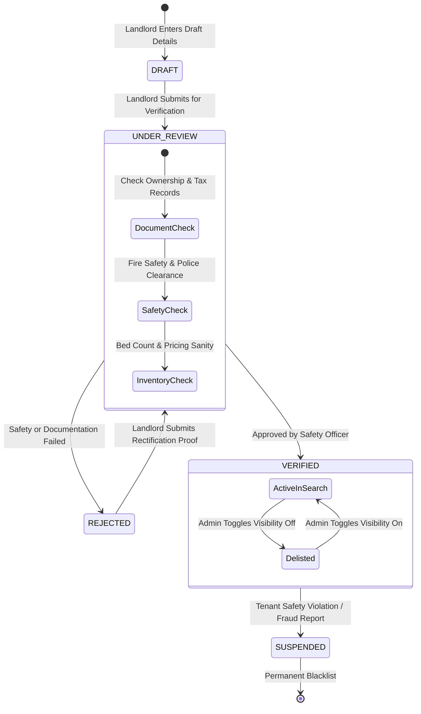
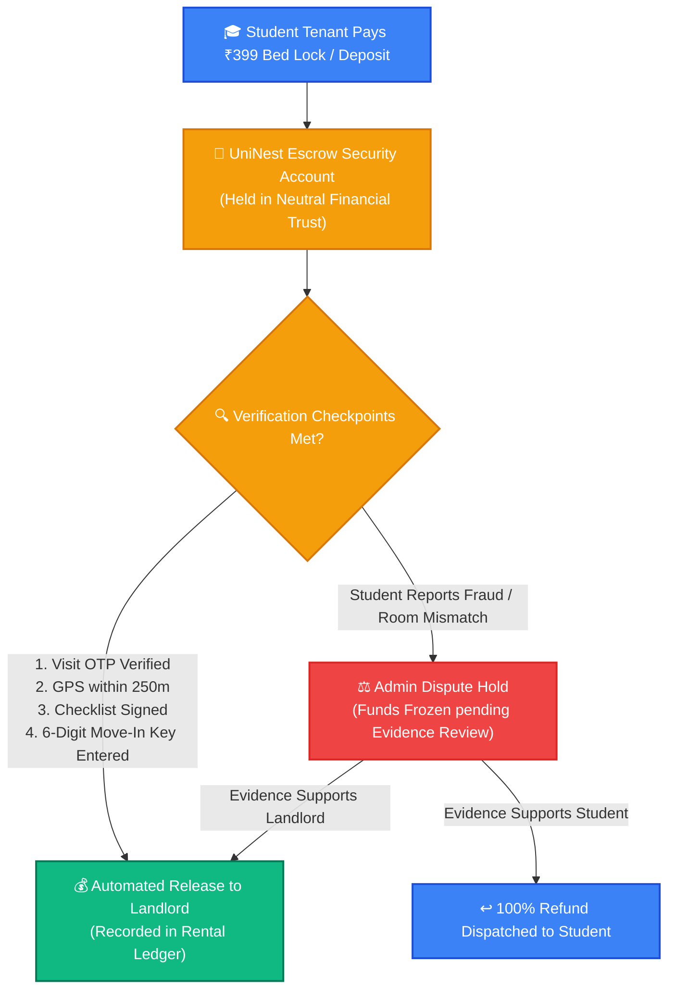

# 🛡️ UniNest Admin & Safety Compliance Portal — Operational Manual

> **Target Audience:** UniNest Platform Administrators, Safety Compliance Officers, Legal Auditors, and Escrow Custodians.  
> **Platform Version:** UniNest 2.0 (Post-Escrow & Two-Stage Handshake Architecture)

---

## 📌 Executive Overview: The Trust Engine of UniNest

The UniNest platform operates on a **zero-trust safety model**. Unlike open listing classifieds where anyone can post unvetted photos and demand cash advances, UniNest acts as the certified intermediary ensuring:
1. **Listing Integrity:** No property goes live to students without passing admin document verification and safety audit.
2. **Deposit Escrow Protection:** Holding student reservation and move-in fees in escrow until physical GPS arrival and checklist sign-off are verified.
3. **Dispute Adjudication:** Providing fair arbitration when tenants or landlords dispute maintenance damage, electricity bills, or notice period refunds.
4. **Instant Delisting Capabilities:** Immediate removal of non-compliant, unsafe, or misrepresented properties from student search.

---

## 🗺️ Administrative Workflows & Governance Diagrams

### 1. Property Safety Audit & Search Visibility State Machine

---

### 2. Dual-Handshake Escrow Custody & Fund Flow Architecture

---

## 🔍 Feature-by-Feature Deep Dive for Administrators

### 1. Platform KPI Dashboard (`/admin/dashboard` & `/admin/analytics`)
- **Total Rental Volume:** Real-time monitoring of monthly rental transacted through UniNest escrow.
- **Bed Inventory Health:** Live tally of Total Beds, Occupied Beds, Reserved Beds, and Platform Occupancy Rate (target >85%).
- **Open Safety Tickets:** Instant view of active emergency panic alerts, unresolved safety tickets, or compliance disputes requiring immediate intervention.

### 2. Property Directory & Search Visibility (`/admin/properties`)
- **Instant Search Visibility Toggle:** With a single click on **"Active in Search"**, admins can instantly publish or delist properties from the student search index without deleting historical data.
- **Database & PropertiesStore Synchronization:** Every visibility change updates:
  - In-memory propertiesStore for instant millisecond search response.
  - PostgreSQL Prisma database with `verificationStatus: VERIFIED`, `isActive: true`, and timestamped `verifiedAt`.
- **Inventory Audit Modal:** View bed-by-bed sharing breakdown, pricing per room, and landlord contact details before approving.

### 3. Verification & Safety Center (`/admin/verification`)
- **Safety Documentation Audit:** Inspect fire extinguisher certificates, CCTV coverage proof, and building safety NOCs.
- **Formal Rejection Notices:** If a property fails compliance, admins enter a specific reason (e.g., *"CCTV camera coverage missing at entrance gate; fire extinguisher expired in March 2026"*). An official compliance notification is dispatched automatically to the landlord's message center.
- **Audit Logging:** Every approval, rejection, or delist action logs the administrator's ID, timestamp, and audit notes into the immutable platform audit ledger (`/admin/audit-log`).

### 4. Dispute Resolution & Arbitration Desk (`/admin/disputes`)
- **Evidence Dossier Inspection:** Review uploaded photos, chat histories, sub-meter readings, and signed digital agreements.
- **Adjudication Actions:**
  - `REFUND_TENANT`: Release held deposit back to student bank account.
  - `PAY_LANDLORD`: Compensate landlord for legitimate damage or unserved notice periods.
  - `SPLIT_SETTLEMENT`: Mutual amicable compromise determined by the compliance arbitrator.

---

## 💡 Strategic Advice & Best Practices for Administrators

> [!IMPORTANT]
> **Check Landlord Phone & Identity on First Listing:**  
> When a new landlord registers a property with custom localities, verify the host phone number via a quick introductory verification call before toggling **Active in Search**.

> [!TIP]
> **Audit Flagged Geofence Discrepancies:**  
> If multiple students report "Out of Geofence Range" for a specific property, check the property's latitude and longitude in the Admin Properties directory. Correcting property coordinates takes under 30 seconds and ensures seamless check-ins.

> [!NOTE]
> **Enforce 24-Hour Dispute SLAs:**  
> Student disputes regarding security deposits should be reviewed within 24 hours to maintain high confidence in the UniNest brand across campus communities.
