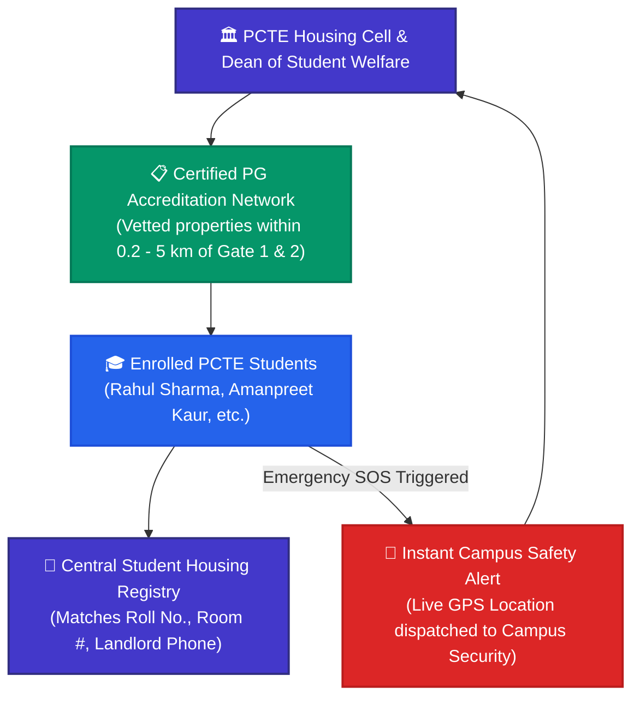
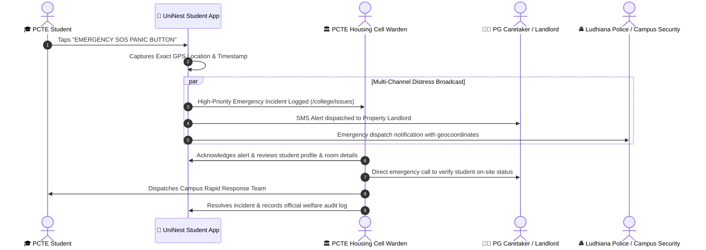

# 🏫 UniNest PCTE Housing Cell Portal — Institutional Oversight Guide

> **Target Audience:** College Housing Cell Officers, Deans of Student Welfare (DSW), Campus Wardens, and Institutional Safety Committees.  
> **Platform Version:** UniNest 2.0 (Post-Escrow & Two-Stage Handshake Architecture)

---

## 📌 Executive Overview: Why Universities Need UniNest

Colleges like **PCTE Group of Institutes** (Baddowal, Ludhiana) attract thousands of students from across Punjab, other Indian states, and international destinations. However, on-campus hostels often reach **100% capacity**, forcing 60%+ of students into unaccredited off-campus PGs.

When students live in unmonitored private accommodations, universities face serious institutional risks:
1. **Safety & Welfare Blindspots:** Lack of knowledge regarding where outstation students reside off-campus.
2. **Guardian Escalations:** Distressed parents calling university authorities over fraudulent landlords or withheld deposits.
3. **Discipline & Curfew Vulnerabilities:** Non-compliant hostels operating without security guards or verified visitor registers.

**The UniNest College Portal bridges the gap between the university and verified private housing providers:**
- Real-time institutional visibility over verified PGs within 5 km of PCTE Campus.
- Live registry matching enrolled PCTE students with their active off-campus residential addresses.
- Direct integration with Student Emergency SOS panic alerts.
- Data-driven analytics on student commute times, living costs, and welfare satisfaction.

---

## 🗺️ Institutional Governance & Safety Architecture

### 1. PCTE Housing Cell Ecosystem Loop

---

### 2. Student Safety & Emergency Incident Escalation Workflow

---

## 🔍 Feature-by-Feature Deep Dive for PCTE Housing Cell

### 1. Institutional Housing Overview (`/college/dashboard`)
- **Off-Campus Student Population:** Live count of verified students residing in authorized accommodations near campus.
- **Accredited Property Density:** Number of UniNest verified PGs within 1 km, 3 km, and 5 km of PCTE Baddowal Campus.
- **Campus Overflow Triage (`/college/overflow`):** When campus dormitories reach full occupancy during August/September admissions, the Housing Cell can instantly guide students to verified private rooms.

### 2. Verified Accommodations Directory (`/college/verified-pgs`)
- **Curated Campus Vicinity List:** Inspect accommodations located specifically on Ferozepur Road, BRS Nagar, and nearby student sectors.
- **Safety Standard Badges:** Check biometric entry systems, fire NOCs, and female-only warden supervision for girls' residences.
- **Proximity Metrics:** See exact walking and transit commute times (e.g., *"3 mins walk to PCTE Gate 2"*).

### 3. Student Tenancy Registry (`/college/students`)
- **Roll Number & Resident Mapping:** Search any student by name or university ID to view:
  - Exact property name, room number, and bed label.
  - Landlord name and direct verified emergency phone number.
  - Active lease start date and duration.
  - Move-in verification status (GPS physical arrival confirmation).

### 4. Incident Management & Grievance Desk (`/college/issues`)
- **Discipline & Safety Tracking:** Monitor reported safety incidents, late-night gate closing non-compliance, or landlord misconduct.
- **Joint University-UniNest Arbitration:** Interface with UniNest Admin for rapid delisting of any property that violates student safety standards.

### 5. Campus Housing Analytics (`/college/analytics`)
- **Cost-of-Living Index:** Monitor whether student rents remain reasonable or if landlords are attempting cartel-like rent spikes.
- **Geographic Commute Distribution:** Heatmap showing where students congregate, enabling PCTE transport cells to optimize campus bus routes.

---

## 💡 Strategic Advice & Best Practices for PCTE Housing Cell

> [!TIP]
> **Share Verified Directory During New Student Orientation:**  
> Provide new first-year students and parents with the UniNest verified QR link during admission counseling to protect them from unverified local street brokers.

> [!IMPORTANT]
> **Audit Emergency Contacts in Student Registry:**  
> Prior to term commencement, verify that all outstation students have active guardian emergency phone numbers registered in their UniNest profiles.

> [!NOTE]
> **Use Analytics for Campus Shuttle Routing:**  
> Check the **Housing Analytics** tab each semester to view where off-campus student concentrations are highest (e.g., BRS Nagar vs. Ferozepur Road) to plan university shuttle pickup points.
