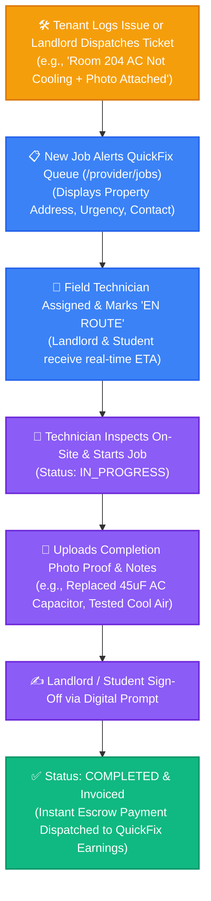
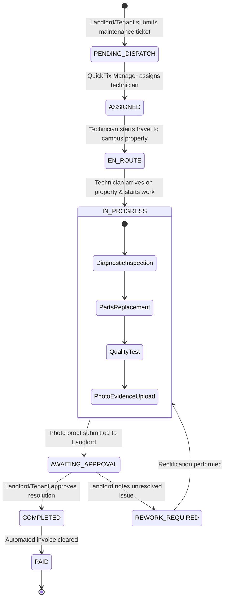

# 🔧 QuickFix Maintenance & Service Partner Portal — Operational Guide

> **Target Audience:** QuickFix Technicians, Electricians, Plumbers, Service Contractors, and Field Maintenance Managers.  
> **Platform Version:** UniNest 2.0 (Post-Escrow & Two-Stage Handshake Architecture)

---

## 📌 Executive Overview: Why UniNest for QuickFix Partners?

Student accommodations and private PGs require continuous, reliable facility maintenance: air conditioning servicing in hot summer months, geyser repairs in winter, plumbing leaks, and sub-meter installations.

Traditional repair handymen face irregular work, delayed cash payments from landlords, and vague descriptions of problems. 

**UniNest empowers QuickFix service partners through a streamlined digital maintenance pipeline:**
- Guaranteed job dispatches from 50+ campus PGs with zero customer acquisition costs.
- Detailed ticket descriptions with attached high-resolution photos and tenant notes before dispatch.
- Direct digital payments with zero cash chasing.
- Automated invoice generation and verified customer reviews on your profile.

---

## 🗺️ Service Partner Execution & Lifecycle Workflows

### 1. Maintenance Ticket to QuickFix Job Lifecycle

---

### 2. Service Job State Transition Engine

---

## 🔍 Feature-by-Feature Deep Dive for QuickFix Providers

### 1. Job Queue & Real-Time Dispatch (`/provider/jobs`)
- **Categorized Work Orders:** Filter jobs by trade category:
  - ⚡ **Electrical:** Sub-meter replacements, short circuit fixes, fan capacitor changes.
  - 🚿 **Plumbing:** Geyser servicing, tap leakages, drain unclogging, flush tank repairs.
  - ❄️ **Air Conditioning:** Summer gas recharging, filter chemical cleaning, compressor fixes.
  - 🪚 **Carpentry:** Study table hinge repairs, door lock & latch replacements.
- **Priority SLAs:**
  - 🔴 **CRITICAL (2-Hour SLA):** Water supply disruption or electrical outage.
  - 🟡 **STANDARD (24-Hour SLA):** Wi-Fi router relocation, minor furniture squeaks.

### 2. Standardized Transparent Rate Card (`/provider/pricing` & `/provider/services-list`)
- Standard upfront pricing prevents bargaining on-site:
  - AC Deep Chemical Cleaning: ₹599
  - PSPCL-Approved Digital Sub-Meter Installation: ₹850
  - Geyser Element Replacement & Descaling: ₹499
  - Single Tap / Angle Valve Fitting: ₹149

### 3. Technician Availability Scheduler (`/provider/availability`)
- Manage team schedules across Ludhiana campus zones (Ferozepur Road, BRS Nagar, Aggar Nagar).
- Toggle working hours and assign shifts to specific field electricians or plumbers.

### 4. Earnings & Invoicing Ledger (`/provider/earnings`)
- Instant credit upon job completion sign-off.
- Export monthly GST invoices and statement summaries for business accounting.
- Direct-to-bank settlement with zero deduction delays.

### 5. Quality Ratings & Customer Reviews (`/provider/ratings`)
- Receive 5-star ratings from verified students and landlords.
- High-performing technicians with >4.8 average rating gain **"Preferred Partner"** status and first priority in high-value commercial hostel refurbishment orders.

---

## 💡 Strategic Advice & Best Practices for QuickFix Providers

> [!TIP]
> **Always Take Clear "Before" & "After" Photos:**  
> When replacing a faulty sub-meter or leaky pipe, take a clear "Before" photo showing the fault and an "After" photo showing the new installed part and operating dial. This guarantees 100% immediate landlord sign-off without delays.

> [!IMPORTANT]
> **Respect Campus PG Curfew & Gate Rules:**  
> Many student accommodations have strict security hours (typically 10:00 PM gate closing). Ensure all standard scheduled maintenance jobs are scheduled and completed before 8:00 PM unless responding to an emergency water/electrical blackout ticket.

> [!NOTE]
> **Keep Common Spare Parts in Your Mobile Kit:**  
> Standard 16A modular switches, MCBs, 36uF/45uF fan & AC capacitors, and universal tap washers resolve 80% of student tickets in under 20 minutes on the first visit.
