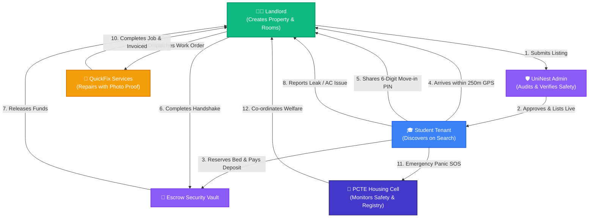

# 📚 UniNest Multi-Role Operational Guidebook (Master Index)

Welcome to the **UniNest Master Documentation & Operational Guidebook**.  
This repository contains complete, role-specific operational manuals with **authentic, working Mermaid architecture diagrams** and **actionable strategic advice** for every stakeholder in the UniNest student housing ecosystem.

---

## 🗂️ Table of Contents & Quick Navigation

| # | Role & Portal | Target Audience | Primary Focus Areas | Documentation File |
|---|---|---|---|---|
| **1** | **👨‍💼 Landlord Portal** | PG Owners, Hostel Caretakers | Room & Bed Setup, Sub-Meters, Rent Ledgers, 2-Stage Move-in | [📖 1_LANDLORD_PORTAL_GUIDE.md](./1_LANDLORD_PORTAL_GUIDE.md) |
| **2** | **🎓 Tenant (Student) Portal** | Students, Hostellers, Parents | Smart Search, TMC Calculator, Geofenced Check-In, e-Stamp | [📖 2_TENANT_STUDENT_PORTAL_GUIDE.md](./2_TENANT_STUDENT_PORTAL_GUIDE.md) |
| **3** | **🛡️ Admin & Safety Portal** | Compliance Officers, Escrow Arbitrators | Safety Audit, Search Visibility, Escrow Custody, Disputes | [📖 3_ADMIN_SAFETY_COMPLIANCE_GUIDE.md](./3_ADMIN_SAFETY_COMPLIANCE_GUIDE.md) |
| **4** | **🏫 PCTE Housing Cell Portal** | College DSW, Wardens, Security | Campus Overflow, Off-Campus Registry, Emergency SOS | [📖 4_PCTE_HOUSING_CELL_GUIDE.md](./4_PCTE_HOUSING_CELL_GUIDE.md) |
| **5** | **🔧 QuickFix Maintenance Portal** | Electricians, Plumbers, Contractors | Job Dispatch, Rate Cards, Photo Proof, Instant Settlement | [📖 5_QUICKFIX_MAINTENANCE_GUIDE.md](./5_QUICKFIX_MAINTENANCE_GUIDE.md) |

---

## 🔄 Cross-Ecosystem Interaction Matrix

---

## 🔑 Default Portal Access Quick Reference (For Demonstrations & Training)

| Portal Role | URL Path | Demo Login Email | Primary Action to Demo |
|---|---|---|---|
| **Landlord** | `/landlord/properties` | `landlord@uninest.in` | Add PG, manage bed occupancy, bill sub-meters |
| **Tenant** | `/student/search` | `rahul@uninest.in` | Search near PCTE, reserve bed, verify GPS move-in |
| **Admin** | `/admin/properties` | `admin@uninest.in` | Toggle "Active in Search", verify listings, escrow audit |
| **College** | `/college/dashboard` | `pcte@uninest.in` | Off-campus student registry, panic alert monitoring |
| **QuickFix** | `/provider/jobs` | `provider@uninest.in` | Accept maintenance ticket, upload photo proof |

---

*Authored by UniNest Engineering & Architecture Team*
